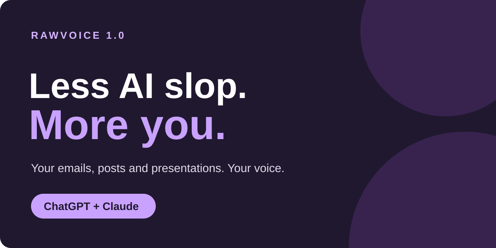

# RawVoice 1.0



## Tired of AI slop?

You asked AI to write an email. It sounds like a press release.

RawVoice helps ChatGPT and Claude learn how you write: the words you use, the tone you like and the phrases you’d never say.

Answer 15 questions or share something you’ve written. Get a voice profile you can reuse for emails, posts, presentations and more.

**Less “in today’s fast-paced world.” More you.**

## See the difference

An authored example for a **fictional persona**, not a recorded model result or a benchmark. Same message: send the draft by Thursday; feedback is due Friday.

| Generic draft | With a direct, friendly voice |
| --- | --- |
| In the spirit of seamless collaboration, please ensure the draft is shared by Thursday to facilitate timely feedback by Friday. | Send me the draft by Thursday, please. I’ll get you feedback by Friday. |

The small voice card behind that example:

> Use everyday words. Make the request clear. Keep emails friendly and short. Skip corporate filler.

[Read the fictional walkthrough](FICTIONAL_DEMO.txt).

## Start with ChatGPT

1. **[Download the ChatGPT starter ZIP](RawVoice_ChatGPT_1.0.zip?raw=true)** and unzip it.
2. Create a private ChatGPT Project. Upload `RAWVOICE_PROJECT_GUIDE.txt` from the starter folder as a Project source.
3. Copy the marked block from `PROJECT_INSTRUCTIONS.txt` into the Project instructions.
4. Start a chat inside that Project and paste:

```text
Start Taste Interviewer in Quick mode using RawVoice. Ask all 15 main questions one at a time. Then create VOICE_PROFILE.md and VOICE_CARD.md for my review. Keep confirmed preferences, inferences and unknowns separate.
```

## Start with Claude

1. **[Download the Claude skill ZIP](RawVoice_Claude_1.0.zip?raw=true)** and leave it zipped. Upload it through Claude’s custom Skills setting and enable it. Turn on code execution and file creation if needed. Use this named ZIP, not GitHub’s automatic Source code download.
2. Create a private Claude Project. Copy the marked block from [PROJECT_INSTRUCTIONS.txt](PROJECT_INSTRUCTIONS.txt) into its instructions.
3. Start a chat inside that Project and paste:

```text
Start Taste Interviewer in Quick mode using RawVoice. Ask all 15 main questions one at a time. Then create VOICE_PROFILE.md and VOICE_CARD.md for my review. Keep confirmed preferences, inferences and unknowns separate.
```

Can’t install custom skills? The [Project-guide route](SETUP_GUIDE.txt) works as a prompt-based alternative.

## Keep your voice for the next chat

Review both generated files. Save the approved `VOICE_PROFILE.md` and `VOICE_CARD.md`, then **add them to your Project’s sources/knowledge yourself**. A chat attachment is not proof they were saved to the Project.

Open a fresh chat **inside the same Project** and try:

```text
Use my saved voice profile to write a short email from these notes:
Please send me the draft by Thursday. I will return feedback by Friday.
```

Check that it follows your preferences and preserves the facts. If file downloads aren’t available, ask for the complete text and save the files manually. Replace outdated Project files when your preferences change.

Already have a voice profile or writing samples? Skip the interview:

```text
Use the attached writing samples or existing profile to create VOICE_PROFILE.md and VOICE_CARD.md. Skip the interview. Keep explicit preferences separate from inferred style, mark unknowns and let me review both files.
```

## What you get

- A detailed voice profile and a short voice card.
- An optional 15-question Quick interview or 100-question Deep interview.
- Guidance for emails, posts, articles, presentations and speaking scripts.
- Format editing and optional text cleanup in the same workflow.
- Profile files you can move privately between ChatGPT and Claude. **Nothing syncs automatically.**

## Check the facts. Keep the voice.

AI can still make mistakes. Review profiles and drafts, and verify factual claims before using them. RawVoice doesn’t promise perfect accuracy, exact imitation or permanent memory. Your files and the host’s available tools determine what it can use.

Recorded end-to-end tests cover **Claude**. A live **ChatGPT Project test is pending**; its setup guide is provided, but this release does not claim a completed ChatGPT test. [Test scope](RELEASE_NOTES.txt) · [Limitations](LIMITATIONS.txt).

## Need a hand?

[Setup and troubleshooting](SETUP_GUIDE.txt) · [Report a problem](https://github.com/b2bmaster/rawvoice/issues/new?template=bug_report.yml) · [Suggest an improvement](https://github.com/b2bmaster/rawvoice/issues/new)

Use fictional or redacted examples in public feedback. Keep your personal profile and interview answers private.

## Downloads and source

[ChatGPT starter](RawVoice_ChatGPT_1.0.zip?raw=true) · [Claude skill](RawVoice_Claude_1.0.zip?raw=true) · [Project guide only](RAWVOICE_PROJECT_GUIDE.txt?raw=true) · [Checksums](SHA256SUMS.txt) · [Source](rawvoice-write-and-edit-prose/)

**1.0 is the first public release version.** Earlier 2.x labels were internal development versions.

[MIT license](LICENSE). Inspired by Ruben Hassid’s Taste Interviewer method; this is not his official release. Independent of OpenAI and Anthropic.
